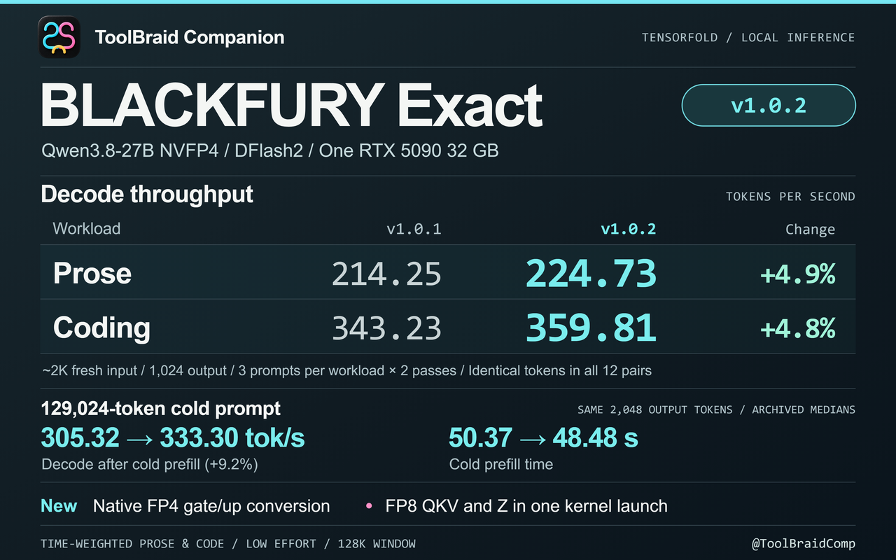

<h1 align="center">BLACKFURY Exact v1.0.2</h1>
<p align="center"><strong>Qwen3.8-27B NVFP4 with DFlash2 on one RTX 5090</strong><br>Native TensorFold CUDA inference for Windows · 131,072-token context · FP8 KV cache</p>

<p align="center">
  <a href="https://github.com/Maharajahu/qwen3.8-27b-nvfp4-blackfury-exact-tensorfold/releases/download/v1.0.2/blackfury-exact-v1.0.2-windows-x64-sm120a.zip"></a>
  <a href="#run-on-windows"></a>
  <a href="#compared-with-v101"></a>
</p>
<p align="center"><a href="https://github.com/Maharajahu/qwen3.8-27b-nvfp4-blackfury-exact-tensorfold/releases/tag/v1.0.2">Release notes</a> · <a href="#measurements">Agent benchmarks</a> · <a href="README-v1.0.1.md#watch">v1.0.1 videos</a> · <a href="https://x.com/ToolBraidComp">ToolBraid on X</a> · <a href="https://buymeacoffee.com/dumitrescup">Buy me a coffee</a></p>

BLACKFURY serves Qwen locally through an OpenAI-compatible API. In v1.0.2 the FP4 gate/up projections use native packed conversion, and the FP8 QKV and Z projections run in a single CUDA kernel launch. On matched prompts, these changes and the updated release profile delivered **359.81 tok/s for source code (+4.8%)** and **224.73 tok/s for prose (+4.9%)** over v1.0.1.

## Compared with v1.0.1

| Generated output | v1.0.1 | v1.0.2 | Change |
|---|---:|---:|---:|
| Prose | 214.25 tok/s | 224.73 tok/s | +4.9% |
| Source code | 343.23 tok/s | 359.81 tok/s | +4.8% |

Three prose prompts and three source-generation prompts were run twice per version on one RTX 5090. Each request had 1,992–2,001 fresh input tokens and generated 1,024 tokens, including reasoning. The four engine launches ran in A–B–B–A order, with the prompt order reversed on the second pass. All 12 cross-version pairs produced identical output token IDs. Fresh prefill on these short inputs averaged 3,825.06 tok/s in v1.0.1 and 3,823.01 tok/s in v1.0.2. [Matched workloads and timings](results/blackfury-v1.0.2/prose-code-comparison.json) · [Prompts](results/blackfury-v1.0.2/prose-code-prompts.json)

On the archived 129,024-token prompt, median decode after cold prefill rose from **305.32 to 333.30 tok/s (+9.2%)**, warm decode rose from **309.53 to 330.77 tok/s (+6.9%)**, and cold prefill took **48.48 s**, down from **50.37 s**. These were separate qualification runs using identical request contents and cache conditions. All samples produced the same 2,048 output token IDs. [Per-run timings and token hashes](results/blackfury-v1.0.2/long-context-comparison.json)

[](https://github.com/Maharajahu/qwen3.8-27b-nvfp4-blackfury-exact-tensorfold/releases/download/v1.0.2/blackfury-exact-v1.0.2.png)

## Run on Windows

Use Windows x64, Python 3.11 or newer, and an RTX 5090 with 32 GB VRAM and a compatible NVIDIA driver. Download and extract the [Windows runtime ZIP](https://github.com/Maharajahu/qwen3.8-27b-nvfp4-blackfury-exact-tensorfold/releases/download/v1.0.2/blackfury-exact-v1.0.2-windows-x64-sm120a.zip). Open PowerShell in the extracted folder that contains `launch.py`.

**If you have the checkpoints**, point the launcher at both directories:

```powershell
python launch.py --model-path 'C:\models\Qwen3.8-27B-NVFP4' --drafter-path 'C:\models\Qwen3.8-27B-DFlash2'
```

<details>
<summary><strong>First install? Download and verify both checkpoints</strong> (24.02 GiB)</summary>

From the same folder, use Git and Python to fetch the pinned [model and drafter revisions](models-manifest.json) and verify their file hashes. Then start the runtime:

```powershell
git clone --depth 1 --branch v1.0.2 https://github.com/Maharajahu/qwen3.8-27b-nvfp4-blackfury-exact-tensorfold.git model-setup
python -m venv .venv
.\.venv\Scripts\python.exe -m pip install -r .\model-setup\requirements.txt
.\.venv\Scripts\python.exe .\model-setup\scripts\setup.py models
$models = (Resolve-Path '.\model-setup\.runtime\models').Path
.\.venv\Scripts\python.exe .\launch.py --model-path "$models\Qwen3.8-27B-NVFP4" --drafter-path "$models\Qwen3.8-27B-DFlash2"
```

</details>

Once the server is ready, run `Invoke-RestMethod http://127.0.0.1:18830/health` in a second PowerShell window. Set your client's base URL to `http://127.0.0.1:18830/v1` and model ID to `blackfury-exact-v1.0.2`.

[Release checksums](https://github.com/Maharajahu/qwen3.8-27b-nvfp4-blackfury-exact-tensorfold/releases/download/v1.0.2/SHA256SUMS.txt) · [Native build kit](https://github.com/Maharajahu/qwen3.8-27b-nvfp4-blackfury-exact-tensorfold/releases/download/v1.0.2/blackfury-exact-v1.0.2-native-build-inputs.zip) · [FP8 attention and inherited prefill diagnostic](docs/blackfury-stage44.md#source-build-and-limitations)

## Measurements

The table gives time-weighted engine rates. The three cold runs give a weighted decode of 333.33 tok/s and a median of 333.30 tok/s.

| Workload | Decode (tok/s) | Fresh prefill (tok/s) |
|---|---:|---:|
| Fixed prompt, 129,024 input + 2,048 output, three cold requests | 333.33 | 2,661.71 |
| Coding requests with file writes or edits, 32 requests | 290.20 | 2,725.61 |
| Coding requests with at least 90,000 input tokens, 8 of the 32 | 277.22 | 2,699.75 |
| Complete agent session, 99 model requests | 274.38 | 2,701.71 |

During a 14-minute Oh My Pi session at low reasoning effort, Qwen built an offline viewer for comparing NVIDIA Nsight traces. The first agent prompt processed **109,211 fresh tokens in 39.27 s**. The largest input was 111,600 tokens. Across 99 requests the model generated 86,553 tokens and OMP compacted its context twice. An independent reviewer reported two issues during the session. Qwen fixed the clock alignment and round selection. The final viewer passed 27 tests and matched all 40 numeric reference values, including a held-out capture.

Decode uses output-token intervals and native decode time. Fresh prefill divides newly processed prompt tokens by native prefill time. Both rates exclude tool execution. [Coding measurements](results/blackfury-v1.0.2/omp-coding.json) · [Release engineering and qualification](docs/blackfury-v1.0.2.md)

## Previous releases and credits

[BLACKFURY Exact v1.0.1 with install guide, benchmarks and recordings](README-v1.0.1.md) · [BLACKFURY Exact](variants/blackfury-exact/README.md) · [Twelve-branch engine](variants/experimental12/README.md) · [Shared-context agent](variants/shared-context/demo/README.md)

Built on [TensorFold](https://github.com/ashhart/TensorFold) by Ash (@ashhart) and its contributors. Model and drafter attribution is in [CREDITS.md](CREDITS.md). Local changes are licensed under [Apache-2.0](LICENSE). [Upstream and third-party notices](licenses/TensorFold) apply to their respective components.
